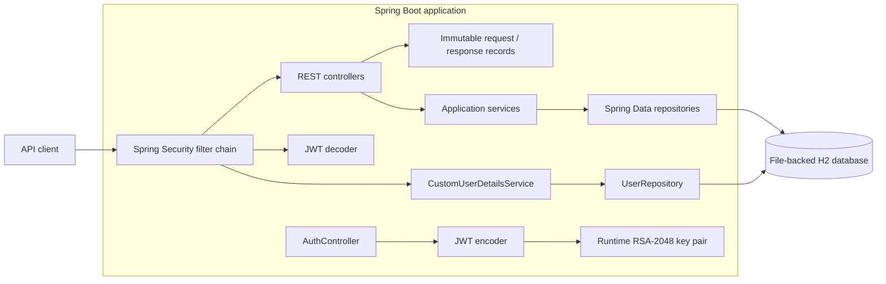
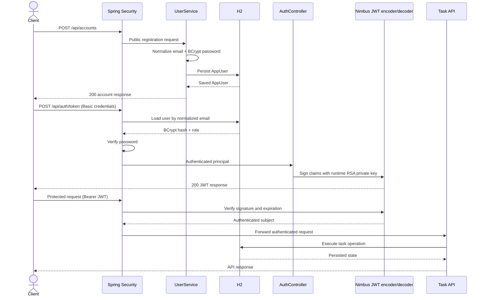
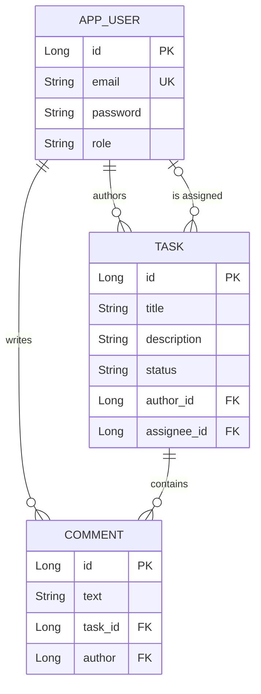

# Task Management System — Secure Spring Boot REST API

[](build.gradle)
[](build.gradle)
[](src/main/java/com/example/task_management_system/config/SecurityConfig.java)
[](build.gradle)
[](src/main/resources/application.properties)
[](gradle/wrapper/gradle-wrapper.properties)

A stateless REST API for coordinating work between registered users. The
system supports task ownership, assignment, lifecycle updates, and discussion
through comments, backed by Spring Data JPA and protected with a Basic-to-JWT
authentication flow.

Built as an engineering portfolio project to demonstrate layered backend
design, explicit API contracts, authentication and authorization boundaries,
relational domain modeling, and honest technical trade-offs. It is a focused
backend case study rather than a finished production service; the current
boundary and next engineering steps are documented in
[Engineering roadmap](#engineering-roadmap).

---

## Core capabilities

- **Account registration:** validates email and password input, normalizes
  emails to lowercase, rejects duplicates, and stores BCrypt password hashes.
- **Stateless authentication:** exchanges HTTP Basic credentials for an
  RSA-signed JWT, then accepts that token as a bearer credential.
- **Task workflow:** creates tasks, lists them in descending ID order, and
  filters them by author and/or assignee.
- **Task collaboration:** lets an author assign or unassign a user, while the
  author or assignee may update task status.
- **Comments:** authenticated users can add comments to a task and retrieve its
  comment history.
- **Boundary validation:** uses Jakarta Bean Validation on request records and
  maps validation and domain failures through a central exception handler.

## Architecture

The application is a single Spring Boot service with a layered request path.
Most code is grouped by feature (`auth`, `user`, and `task`), while
cross-cutting security, configuration, and exception behavior lives in
dedicated packages.



### Request flow

1. The Spring Security filter chain authenticates the request with HTTP Basic
   or a bearer JWT.
2. A controller validates the HTTP payload and combines it with the
   authenticated principal when the operation needs caller context.
3. The service layer performs orchestration and task ownership checks.
4. Spring Data repositories load and persist JPA entities.
5. Controllers return explicit response records rather than exposing entity
   graphs directly.
6. `GlobalExceptionHandler` translates validation and domain failures into
   HTTP responses.

The task write paths make the boundary especially visible:

```text
PostTaskBody (HTTP payload)
    → PostTaskRequest (payload + authenticated author)
        → TaskService
            → Task entity
                → PostTaskResponse (controlled HTTP response)
```

### Authentication lifecycle



The token currently expires **60 seconds** after issuance. The configuration
also contains `jwt.expiration-minutes=60`, but that property is not yet wired
into token generation; this mismatch is called out in the roadmap rather than
hidden by the documentation.

## Domain model



| Entity | Responsibility | Important constraints |
| --- | --- | --- |
| `AppUser` | Authentication identity and task participant | Unique email, BCrypt password, default `USER` role |
| `Task` | Unit of work owned by an author | Required title, description, author, and initial `CREATED` status; optional assignee |
| `Comment` | User-authored discussion attached to a task | Belongs to one task and one author |

The task lifecycle accepts `CREATED`, `IN_PROGRESS`, and `COMPLETED` through
the [`TaskStatus`](src/main/java/com/example/task_management_system/task/enums/TaskStatus.java)
API enum. The entity currently persists that value as a string; moving the
enum into the persistence model is a planned type-safety improvement.

## Tech stack

| Layer | Technology |
| --- | --- |
| Language and build | Java 25 toolchain · Gradle 9.5.1 wrapper |
| Application | Spring Boot 4.0.6 · Spring Web |
| Security | Spring Security · HTTP Basic · OAuth2 Resource Server · Nimbus JWT · RSA-2048 · BCrypt |
| API contracts | Java records · Jakarta Bean Validation |
| Persistence | Spring Data JPA · Hibernate · file-backed H2 |
| Error handling | `@RestControllerAdvice` · structured `ErrorResponse` record |
| Testing | JUnit 5 · Spring Boot Test |

## Design decisions and trade-offs

### Feature-oriented organization

Controllers, services, repositories, and DTOs for users and tasks are
co-located by domain instead of being spread across global technical-layer
folders. This makes a feature easier to trace and gives it a clear extraction
path if the codebase later becomes modular. `Comment` and its repository
currently live in a small generic `entities` package even though the behavior
belongs to tasks; consolidating that package is a future cleanup.

### Explicit DTO boundaries

The API returns Java records instead of serializing JPA entities. Task write
operations distinguish the raw HTTP body, an internal request containing
authenticated caller context, and the response contract. This avoids leaking
security or servlet types into the core operation and prevents accidental
exposure of passwords or relationship graphs. The cost is additional mapping
code, accepted here in exchange for a controlled public contract.

### Basic-to-JWT authentication flow

The intended client flow uses Basic authentication to obtain a short-lived
token and bearer authentication for subsequent requests. The server remains
stateless, passwords are verified through BCrypt, and JWTs are signed
asymmetrically so verification needs only the public key. Both authentication
mechanisms are currently accepted on every protected endpoint; narrowing Basic
authentication to the token route is a future hardening step.

### Business authorization in the service layer

Task assignment is restricted to the task author. Status changes are allowed
for either the author or the assigned user. Keeping these checks beside the
business operation makes the behavior testable without a web request, but the
current use of `ResponseStatusException` couples service code to HTTP. Domain
exceptions or method-level authorization would provide a cleaner separation as
the rule set grows.

### Derived persistence queries

`TaskRepository` expresses author and assignee filters through Spring Data
method names and applies an explicit descending-ID sort. This keeps a compact
query layer for the current use case. More complex search, pagination, and
query composition would justify specifications or purpose-built queries.

### Centralized error translation

`GlobalExceptionHandler` centralizes validation failures, duplicate accounts,
HTTP-aware service failures, malformed request bodies, and unexpected
exceptions. Most failures use a shared response envelope containing status,
error, details, and timestamp. Malformed bodies currently return plain text,
so making all error paths conform to one contract remains planned work.

## Project structure

```text
src/
├── main/
│   ├── java/com/example/task_management_system/
│   │   ├── auth/          # JWT issuance endpoint and response contract
│   │   ├── config/        # Security filter chain and RSA/JWT beans
│   │   ├── dto/           # Shared error response
│   │   ├── entities/      # Comment entity and repository
│   │   ├── exception/     # Domain exception and global HTTP mapping
│   │   ├── security/      # Database-backed UserDetailsService
│   │   ├── task/          # Task API, service, model, repository, DTOs
│   │   ├── user/          # Registration API, service, model, repository
│   │   └── TaskManagementSystemApplication.java
│   └── resources/
│       ├── application.properties
│       └── static/index.html
└── test/
    └── java/.../TaskManagementSystemApplicationTests.java
```

Useful entry points:

- [`SecurityConfig`](src/main/java/com/example/task_management_system/config/SecurityConfig.java)
  defines authentication mechanisms, public routes, stateless sessions, and
  the password encoder.
- [`AuthController`](src/main/java/com/example/task_management_system/auth/AuthController.java)
  builds and signs JWT claims.
- [`TaskService`](src/main/java/com/example/task_management_system/task/TaskService.java)
  contains task orchestration and authorization rules.
- [`GlobalExceptionHandler`](src/main/java/com/example/task_management_system/exception/GlobalExceptionHandler.java)
  owns exception-to-response translation.

## Quick start

### Prerequisites

- JDK 25, matching the Gradle Java toolchain declared in `build.gradle`
- A free local port `8080`
- No external database is required

The repository includes the Gradle wrapper, so a separate Gradle installation
is not needed.

### 1. Run the tests

```bash
# macOS / Linux
./gradlew test
```

```powershell
# Windows PowerShell
.\gradlew.bat test
```

### 2. Start the API

```bash
# macOS / Linux
./gradlew bootRun
```

```powershell
# Windows PowerShell
.\gradlew.bat bootRun
```

The application starts at [http://localhost:8080](http://localhost:8080).

### 3. Development database

The H2 Console is available at
[http://localhost:8080/h2-console](http://localhost:8080/h2-console):

| Setting | Value |
| --- | --- |
| JDBC URL | `jdbc:h2:file:../tms_db` |
| User | `sa` |
| Password | `sa` |

H2 Console access, default credentials, and
`spring.jpa.hibernate.ddl-auto=update` are local-development choices, not a
production database strategy.

## API reference

All routes except account registration and static development resources
require authentication. The intended flow is Basic credentials for token
issuance followed by a bearer token for task operations.

| Method | Path | Authentication | Current authorization | Purpose |
| --- | --- | --- | --- | --- |
| `POST` | `/api/accounts` | Public | Anyone | Register an account |
| `GET` | `/api/auth` | Basic or Bearer | Any authenticated user | Return a simple principal/authority diagnostic |
| `POST` | `/api/auth/token` | Basic or Bearer | Any authenticated user | Issue a 60-second JWT |
| `GET` | `/api/tasks` | Basic or Bearer | Any authenticated user | List tasks; optionally filter by `author` and `assignee` |
| `POST` | `/api/tasks` | Basic or Bearer | Any authenticated user | Create a task owned by the caller |
| `PUT` | `/api/tasks/{taskId}/assign` | Basic or Bearer | Task author | Assign a registered user or send `none` to unassign |
| `PUT` | `/api/tasks/{taskId}/status` | Basic or Bearer | Task author or assignee | Set `CREATED`, `IN_PROGRESS`, or `COMPLETED` |
| `PUT` | `/api/tasks/{taskId}/comments` | Basic or Bearer | Any authenticated user | Add a comment |
| `GET` | `/api/tasks/{taskId}/comments` | Basic or Bearer | Any authenticated user | List comments for a task |

Task filters may be combined:

```http
GET /api/tasks?author=alice@example.com
GET /api/tasks?assignee=bob@example.com
GET /api/tasks?author=alice@example.com&assignee=bob@example.com
```

### End-to-end workflow

The following Bash-compatible example uses `curl` and `jq`. Because the
implemented token lifetime is 60 seconds, run the protected calls promptly or
request a fresh token.

```bash
BASE_URL="http://localhost:8080"

# 1. Register the task author.
curl -s -X POST "$BASE_URL/api/accounts" \
  -H "Content-Type: application/json" \
  -d '{"email":"alice@example.com","password":"password123"}' | jq

# Register a second account that can be assigned to the task.
curl -s -X POST "$BASE_URL/api/accounts" \
  -H "Content-Type: application/json" \
  -d '{"email":"bob@example.com","password":"password123"}' | jq

# 2. Exchange Alice's Basic credentials for an RSA-signed JWT.
TOKEN=$(curl -s -X POST "$BASE_URL/api/auth/token" \
  -u "alice@example.com:password123" | jq -r '.token')

# 3. Create a task and capture its generated ID.
TASK_ID=$(curl -s -X POST "$BASE_URL/api/tasks" \
  -H "Authorization: Bearer $TOKEN" \
  -H "Content-Type: application/json" \
  -d '{"title":"Document the API","description":"Publish architecture and usage details"}' \
  | jq -r '.id')

# List all tasks.
curl -s "$BASE_URL/api/tasks" \
  -H "Authorization: Bearer $TOKEN" | jq

# 4. Assign the task to Bob. Only Alice, the author, may do this.
curl -s -X PUT "$BASE_URL/api/tasks/$TASK_ID/assign" \
  -H "Authorization: Bearer $TOKEN" \
  -H "Content-Type: application/json" \
  -d '{"assignee":"bob@example.com"}' | jq

# 5. Move the task into progress.
curl -s -X PUT "$BASE_URL/api/tasks/$TASK_ID/status" \
  -H "Authorization: Bearer $TOKEN" \
  -H "Content-Type: application/json" \
  -d '{"status":"IN_PROGRESS"}' | jq

# 6. Add and retrieve a comment.
curl -s -X PUT "$BASE_URL/api/tasks/$TASK_ID/comments" \
  -H "Authorization: Bearer $TOKEN" \
  -H "Content-Type: application/json" \
  -d '{"text":"Architecture section drafted"}'

curl -s "$BASE_URL/api/tasks/$TASK_ID/comments" \
  -H "Authorization: Bearer $TOKEN" | jq
```

The current implementation returns `200 OK` for registration, token issuance,
task creation, updates, and comment creation. It does not yet use `201 Created`
for new resources.

### Representative contracts

Successful account registration:

```json
{
  "id": 1,
  "email": "alice@example.com"
}
```

Successful task creation:

```json
{
  "id": "1",
  "title": "Document the API",
  "description": "Publish architecture and usage details",
  "status": "CREATED",
  "author": "alice@example.com",
  "assignee": "none"
}
```

Bean Validation failure (`400 Bad Request`):

```json
{
  "status": 400,
  "error": "Validation failed",
  "details": {
    "email": "Invalid email"
  },
  "timestamp": "2026-07-29T12:00:00"
}
```

Duplicate account (`409 Conflict`):

```json
{
  "status": 409,
  "error": "Username already exists",
  "details": {
    "username": "alice@example.com"
  },
  "timestamp": "2026-07-29T12:00:00"
}
```

Missing task (`404 Not Found`):

```json
{
  "status": 404,
  "error": "Task not found",
  "details": {
    "message": "Task not found"
  },
  "timestamp": "2026-07-29T12:00:00"
}
```

Assignment attempted by someone other than the author (`403 Forbidden`):

```json
{
  "status": 403,
  "error": "User is not allowed to assign this task",
  "details": {
    "message": "User is not allowed to assign this task"
  },
  "timestamp": "2026-07-29T12:00:00"
}
```

An invalid task status currently produces a plain-text `400` response:

```text
Invalid value. Accepted values are: [CREATED, IN_PROGRESS, COMPLETED]
```

## Testing

The Gradle test task currently passes. The tracked suite contains one
Spring Boot context smoke test:

```text
TaskManagementSystemApplicationTests.contextLoads()
```

That test proves the application context and dependency graph can start, but it
does **not** establish business-rule, security-contract, or endpoint coverage.
The absence of a coverage badge and percentage in this README is deliberate.

The next useful test layers are:

1. **Service unit tests:** registration normalization, duplicate rejection,
   task ownership, assignment, status authorization, and missing entities.
2. **Controller contract tests:** status codes, JSON shapes, validation errors,
   authentication requirements, and filter parameters.
3. **Repository tests:** author/assignee combinations, ordering, and entity
   relationships against H2.
4. **Security integration tests:** Basic-to-JWT issuance, signature validation,
   expiration, and forbidden task operations.

## Engineering roadmap

This project demonstrates the implemented architecture above; it does not
present the following work as complete:

- **Persist and rotate RSA keys.** A new RSA-2048 pair is generated at every
  application start, invalidating previously issued tokens. Load keys from a
  keystore or secret manager and define a rotation strategy.
- **Make JWT lifetime configuration authoritative.** Inject
  `jwt.expiration-minutes` into token issuance and remove the current
  hard-coded 60-second expiration.
- **Tighten authorization boundaries.** Restrict Basic authentication to token
  issuance, limit task/comment visibility to participants where appropriate,
  and enforce comment access for the author or assignee.
- **Strengthen the domain model.** Persist `TaskStatus` with
  `@Enumerated(EnumType.STRING)`, replace unsafe `Optional.get()` use, and
  move comment persistence into the task feature.
- **Unify error contracts.** Return `ErrorResponse` for malformed JSON and
  authentication failures as well as validation and service errors.
- **Evolve persistence deliberately.** Replace H2 and `ddl-auto=update` with
  PostgreSQL and versioned Flyway migrations for non-development environments.
- **Publish an API contract.** Add OpenAPI documentation and examples generated
  from the running application.
- **Expand delivery safeguards.** Add the test layers above, a GitHub Actions
  build, container packaging, health checks, and environment-specific
  configuration.

## License

No license file is currently included. Treat this repository as
source-available for portfolio review, not as an open-source distribution.
# Task_Management

